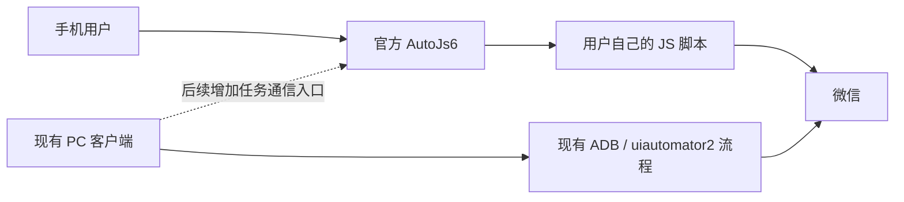

# PC 控制与手机独立运行：采用 AutoJs6 的分阶段方案

核查日期：2026-10-18（Asia/Shanghai）。本文按用户最新澄清确定选型：**手机直接依赖原版 AutoJs6，由用户维护 JS 脚本；PC 保留现有 Tauri 客户端。首版不另建 Kotlin 手机执行器，不要求两端脚本同构。** 已开始实现 [固定启动器和手机脚本更新](../mobile-workflows/README.md)；手机依赖管理、PC 图形化同步及 PC→AutoJs6 通信仍未实现。

## 1. 最终选择

| 部分 | 选择 | 取舍 |
| --- | --- | --- |
| PC 客户端 | 保留 Tauri 2 + Vue + Rust + ADB/uiautomator2 | 已有设备发现、工作流商店、任务、日志与更新；继续利用现有代码 |
| 手机执行环境 | 官方 [AutoJs6](https://github.com/SuperMonster003/AutoJs6) | 已有无障碍 JS 执行、选择器、脚本管理；不用先重写自动化引擎 |
| 手机业务 | 用户自己的 AutoJs6 脚本项目 | 先在原版宿主里运行，脚本内容与 PC JSON 工作流可以分别维护 |
| 远期独立 APK | 暂缓 | 需要自有品牌时，再评估 AutoJs6 打包运行器；不把这一步设为手机可用的前置条件 |

AutoJs6 官方源码和文档能确认脚本、打包、网络和更新能力，但不能据此承诺现有微信流程已通过客户手机测试。[项目说明](https://github.com/SuperMonster003/AutoJs6/blob/master/README.md)、[脚本执行文档](https://github.com/SuperMonster003/AutoJs6/blob/master/app/src/main/assets-app/docs/engines.html)。

这次建议优先考虑脚本交付速度和现有 PC 的复用率，不宣称 AutoJs6 在所有机型上优于原生实现。此前原生 Agent 研究保留为技术备选，见 [系统约束核查](../work/android-agent-runtime-findings.md)。

## 2. 两种使用方式

**手机独立使用：** 安装 AutoJs6 → 导入脚本项目 → 开启运行所需的无障碍等权限 → 在手机上运行或配置定时任务。执行不应依赖电脑在线。日/周/单次调度可优先利用宿主能力；PC 的五段 Cron 不是已验证的手机兼容格式，若要相同语义仍需适配。[定时调度源码](https://github.com/SuperMonster003/AutoJs6/tree/master/app/src/main/java/org/autojs/autojs/timing)。

**PC 控制：** 现有 PC 的 ADB/uiautomator2 工作流继续保留。若需要从 PC 直接执行用户的 AutoJs6 脚本，则新增一个手机侧控制入口脚本及 PC 通信模块；不要把“安装了 AutoJs6”误写成“当前 PC 已能下发 JS 任务”。

AutoJs6 提供基于 OkHttp 的 WebSocket 能力，可作为通信基础；配对、任务协议、队列和日志回传仍需我们开发。[WebSocket 实现](https://github.com/SuperMonster003/AutoJs6/blob/master/app/src/main/java/org/autojs/autojs/core/web/WebSocket.kt)。

## 3. PC 下载、安装与脚本分发

拟在 PC 的环境管理里新增：

1. **下载 / 安装 AutoJs6：** 从上游正式 Release 下载与手机 ABI 匹配的原版 APK；校验下载内容，缓存到本机，再对用户勾选的手机执行 ADB 安装。保留上游签名，不改包名或重新签名。升级用 `adb install -r`，不通过卸载重装升级。[官方 Release](https://github.com/SuperMonster003/AutoJs6/releases)、[ADB 安装命令](https://developer.android.com/tools/adb#pm)。
2. **下载 / 同步手机脚本：** 从用户自己的 GitHub 仓库获取项目包、版本和摘要，传到手机可导入的位置，再由 AutoJs6 导入或由项目入口加载。实际导入路径和启动方式需按宿主正式版验证，不能仅凭一次 `adb push` 就认定脚本已正确安装。
3. **检查运行环境：** 显示宿主安装状态、脚本版本、连接状态和需要用户处理的授权项；系统无障碍授权由用户完成。[无障碍服务](https://developer.android.com/reference/android/accessibilityservice/AccessibilityService#ServiceLifecycle)。

官方 v6.7.0 的 arm64-v8a 主程序 APK 为 139,193,973 字节（约 133 MiB），universal 为 220,337,309 字节；这是完整宿主的发布资产大小，不是本项目实测的裁剪包大小。[v6.7.0 Release API](https://api.github.com/repos/SuperMonster003/AutoJs6/releases/tags/v6.7.0)。**PC 按需下载并复用缓存，不将这个 APK 塞进现有 EXE。**

手机 JS 建议另设 `mobile-workflows/` 和独立目录清单，继续使用同一个 GitHub 仓库即可；现有 `workflows/` 只维持 PC JSON 契约。当前索引生成器要求每个工作流目录有 `workflow.json`，不能不改生成器就往其中混放任意手机脚本目录。

## 4. 把两类升级分开

| 更新对象 | 由谁发布 | 用户看到的行为 |
| --- | --- | --- |
| AutoJs6 本体 | AutoJs6 上游 | 原版宿主已有自动检查、提示、下载及启动安装的实现；PC 也可下载推荐版本后覆盖安装 |
| 用户的 JS 脚本 / 项目 | 用户自己的仓库 | 项目入口检查自己的版本清单，下载并校验新脚本，在当前任务结束后切换版本；无需随每次脚本变更重新安装 AutoJs6 |
| 现有 PC 客户端 | 当前 Por Auto Release | 继续使用现有 Tauri Updater；不与 AutoJs6 上游的版本号或发布渠道混用 |

已核实的宿主更新入口：[UpdateUtils.autoCheckForUpdatesIfNeededWithSnackbar](https://github.com/SuperMonster003/AutoJs6/blob/master/app/src/main/java/org/autojs/autojs/util/UpdateUtils.kt)、[UpdateChecker](https://github.com/SuperMonster003/AutoJs6/blob/master/app/src/main/java/org/autojs/autojs/network/UpdateChecker.java)。这是宿主本体更新，不会自动替用户更新业务 JS。

脚本更新器已按 [手机脚本说明](../mobile-workflows/README.md) 实现首版：固定可信仓库及版本快照；先下载完整并校验，再切换入口；本地配置、任务记录和日志另存，避免更新覆盖；失败继续使用旧脚本。私有源授权与现有 PC 策略保持一致，避免将仓库令牌写入脚本或日志。

手机安装升级要处理系统确认、安装来源授权及失败状态，不能保证所有手机都能静默升级；同包名、兼容签名及递增 versionCode 是正常原位升级的基础。[PackageInstaller](https://developer.android.com/reference/android/content/pm/PackageInstaller#STATUS_PENDING_USER_ACTION)、[Android 签名](https://developer.android.com/studio/publish/app-signing#considerations)。这些是安装行为边界，不要求为使用 AutoJs6 另开发一个 APK。

若未来另发自有 Android APK，需要独立发布渠道，不能将 Android-only Release 设为当前仓库默认 Latest：现有 PC 更新器固定读取 `releases/latest/download/latest.json`，否则会破坏 PC 更新发现。

## 5. PC 联动的最小增量

当用户需要 PC 管理 AutoJs6 脚本时，再增加一个轻量控制项目：

- 手机明确开启“接受电脑任务”；首版走已授权 USB 的端口转发/反向转发，通信只绑定本机，使用配对凭据；局域网控制后续再加 TLS 和设备配对。[ADB 端口转发](https://developer.android.com/tools/adb#forwardports)。
- PC 只提交已安装脚本的标识、参数和唯一任务 ID，避免把调试用的任意代码执行入口暴露到网络。手机任务队列统一接收本机与 PC 请求，同一个任务 ID 重发只返回已有状态。
- 单手机串行、不同手机并行；PC 旧 uiautomator2 模式与 AutoJs6 模式显式互斥。不要让两者同时操作同一屏幕；UiAutomation 默认可能抑制其他无障碍服务，切换时还需核对服务状态。[UiAutomation 标志](https://developer.android.com/reference/android/app/UiAutomation#FLAG_DONT_SUPPRESS_ACCESSIBILITY_SERVICES)。
- 手机保存运行日志、版本、步骤和发送前后证据，PC 拉取/导出；消息发送状态不明时不自动重试。停止在安全的步骤边界生效，不能承诺撤回已经发出的消息。

## 6. 首次验收范围

先用一台客户手机验证：手机本地运行脚本、中文输入、列表首个会话判断、一次发送、日志保存，以及升级后脚本和配置仍在。再验证 PC 安装宿主、同步脚本；最后接 PC 下发与多手机。

AutoJs6 是执行环境，不会自动适配所有微信版本，也不自动实现手机脚本商店、自己的更新器、PC 任务桥或可靠断点恢复。定时后台行为仍受系统、锁屏与厂商设置影响。[后台限制核查](../work/android-agent-runtime-findings.md)。

本文保留选型和后续 PC 集成计划；固定启动器、版本清单及手机脚本更新的实现与验证进度见 [手机脚本说明](../mobile-workflows/README.md)。
